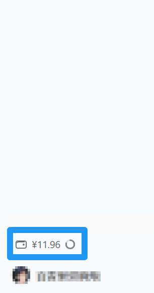
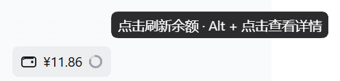
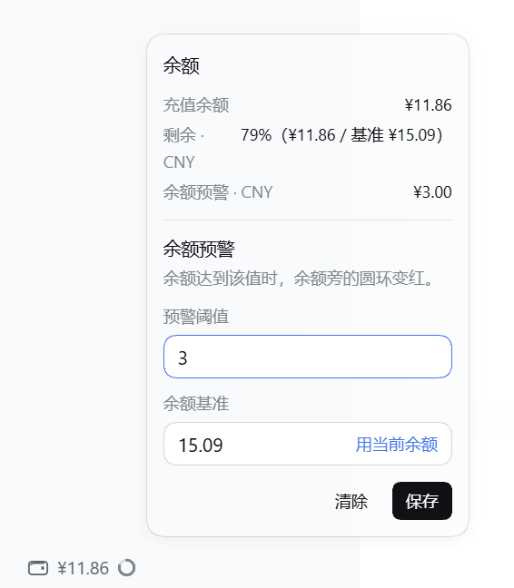

# dsh-usage-balance

在 [DeepSeek Harness](https://github.com/deepseek-ai/deepseek-harness)（dsh）侧边栏底部显示账号余额与**余额剩余比例环**；余额达到你设定的预警阈值时圆环变红。

一个 Host 半边（占位）+ 一个浏览器半边（全部界面），**零运行时依赖**，不需要构建步骤。



> 英文摘要：A DeepSeek Harness plugin that shows the account balance and a remaining-share ring in the sidebar footer. Both the ring's denominator (a baseline you enter) and the alert threshold are yours to set; the ring turns red once the balance reaches the threshold. No build step, no runtime dependencies. See [安装](#安装) — install it from the Plugins page by absolute path.

---

## 目录

- [功能](#功能)
- [安装](#安装)
- [使用](#使用)
- [数据与存储](#数据与存储)
- [前提与限制](#前提与限制)
- [实现要点](#实现要点)
- [开发与验证](#开发与验证)
- [许可](#许可)

---

## 功能

侧边栏底部、"设置"上方多出一行与宿主同款样式的控件。悬停给出操作提示：



Alt + 左键打开的面板，余额明细、基准与阈值都在这里：



| 状态 | 胶囊显示 |
|---|---|
| 读取中 | 图标 + 骨架条 |
| 已登录 | 图标 + 金额 + 圆环 |
| 未登录 | `登录后查看` |
| 读取失败 | 红色 `读取失败`，点击重试 |
| 未充值 | `未充值` |

### 圆环：两个数字都由你决定

插件**不猜**任何分母。你在面板里填两个值，它们共同决定圆环：

| 值 | 作用 |
|---|---|
| **余额基准** | 圆环的分母。`填充比例 = 当前余额 / 基准`，余额越少环越空 |
| **预警阈值** | 只决定颜色。余额 ≤ 阈值时圆环变红 |

两者**按币种分别存储**（CNY、USD 各一套）。没配基准的币种不画环；配了但当前没有该币种钱包时静默跳过，配置保留。

> 因为没有分母就不画环，所以**首次安装后请先打开面板填一个基准**。点「用当前余额」可以一键填成当前余额，环就从 100% 开始。

---

## 安装

需要 dsh 桌面版或 Web 版，且能打开 **Plugins（插件）** 页面。

1. 把本目录放到一个**稳定位置**（不要之后移动或删除）。
2. 侧边栏 → **Plugins** → **Add plugin**。
3. 填入本目录的**绝对路径**，例如：
   ```
   C:\Users\you\plugins\dsh-usage-balance
   ```
4. 安装完成后确认 bundle 已开启，然后**刷新页面**。

安装走的是 profile 的 `link:` 依赖，所以目录必须留在原处；移动目录会导致插件失效，需要重新安装。

---

## 使用

- **左键**胶囊 → 刷新余额。
- **Alt + 左键**（macOS 为 **Option + 左键**）→ 打开面板。

面板里：

- 输入基准时，上面的「剩余」行会**实时预览**新比例，保存前就能看到结果。
- 两个字段一起提交，不会写一半。
- 输入非法会**点名到字段**（`余额基准必须是大于 0 的数字`），且不会落盘。
- 两个字段都清空会被拒绝（否则环没有东西可显示）。
- 「清除」只影响当前编辑的币种。
- 「用当前余额」把基准填成当前余额，**仍需点保存**才生效。

---

## 数据与存储

余额来自宿主已有的 `account.getBalance`——也就是"设置 → 账号"里那张余额卡片用的同一条 Host 查询。插件不直接访问网络，也拿不到你的凭证。

阈值与基准存在浏览器 `localStorage`（展示偏好，不写进 profile 配置）：

| key | 内容 |
|---|---|
| `dsh-usage-balance:thresholds` | 各币种预警阈值，单位「分」的整数 |
| `dsh-usage-balance:baselines` | 各币种余额基准，单位「分」的整数 |

- 换浏览器、清空站点数据会丢失；**卸载重装则保留**。
- 两个字段都按币种分开读写，所以清除一个币种不会动另一个。

---

## 前提与限制

- **余额只对「DeepSeek 账号登录」可见。** 若你在用 API Key 而未登录账号，胶囊会显示 `登录后查看`。
- **宿主没有充值流水接口。** 账号 remote 只暴露余额快照（底层 `/api/v0/users/get_summary`），没有充值记录。所以插件**不会**自动知道"这次充了多少"——基准完全由你手动维护。充值后想重新起算，点「用当前余额」。
- **只统计充值钱包，不含赠金。** 这样赠金发放不会抬高分母、赠金过期也不会看着像消费。纯赠金账号不画环。
- **侧边栏只画一个环。** 同时配置 CNY 与 USD 时，存储与计算是分开的，但胶囊只显示第一个；面板编辑的是"环的币种，否则第一个有钱包的币种，否则 CNY"。
- 面板上报给宿主的 `CLIENT_VERSION = '0.2.0-rc.2'` 是"调用方 UI 身份"用的版本号，随 dsh 升级可同步更新。

---

## 实现要点

给想改代码、或想写同类 dsh 插件的人：

- **包结构**：`package.json` 声明 `dsh.bundle.patch` 与 `dsh.client.platform: 'web'`；`cordis.patch.yml` 往 profile 插入一行；`index.js` 是空的 Host 半边（只为让 bundle 有一行，从而让浏览器半边可被发现）；`client.js` 是全部界面。`client.js` 由宿主按原样作为普通脚本加载，**不经过打包**，所以里面只能用 `React.createElement`，没有 JSX、没有 ESM。
- **渲染进槽位**：注册到 `sidebar.footer.action`（由 `dsh-client-ui-sidebar` 声明的 list 槽位）。组件由框架注入 `t`（翻译）与 `wide`（侧边栏是否展开）。
- **不 import 宿主的 Client 包**（如 `dsh-client-ui-primitives`），这是 dsh 插件规范的要求。因此两处宿主控件是**照抄**而非引用：
  - **Tooltip**：`position: fixed` + 锚点 `getBoundingClientRect()`。几何直接写到 DOM 节点、不经过 state，所以定位不会自触发重渲染。侧边栏列是 `overflow: hidden` 且本组合没有 portal 服务，只有 fixed 能逃出裁剪。
  - **ContextMeter 圆环**：14px viewBox、r=5.5、2px stroke，用 `stroke-dasharray` 填充。
- **只用主题 token**（`--dsw-alias-*`、`--dsw-specific-menu`、`--dsw-elevation-panel` 等），深浅色自动跟随。样式表里没有任何硬编码颜色。
- **纯函数负责计算 + 一个 store 负责读取协调**：`ringReadings(balance, baselines, thresholds)` 之类是纯函数；`createBalanceStore` 处理并发——每个刷新请求会等到"一次在它之后开始的读取"，且只有最新的读取能发布结果，所以慢读不会覆盖新值。
- **文案走 Client locale 服务**，中英两套字典。

---

## 开发与验证

三个离线脚本，对着**真实模块契约**跑（不是对着假设），位于上一层 `plugins/` 目录：

| 脚本 | 覆盖 |
|---|---|
| `../_verify-balance.js` | 注册形状、悬停气泡、五种状态渲染、点击与 Alt+点击、圆环几何与阈值变色、多币种、面板两个字段的校验与保存、清除范围、rebase |
| `../_probe-store.js` | 数据层：首读、并发刷新不被慢读覆盖、未登录不重复请求、拒绝与抛错、金额格式 |
| `../_verify-theme.js` | 把插件引用的每个 `--dsw-*` 变量沿 `var()` 链解析成最终色值，逐项比对深浅两套调色板 |

```bash
node ../_verify-balance.js
node ../_probe-store.js
node ../_verify-theme.js
```

三个脚本都以**非零退出码**表示失败。`_verify-theme.js` 还会拒绝两类问题：引用了不存在的变量、以及某个表面在深浅两色下取值相同。

---

## 许可

MIT
